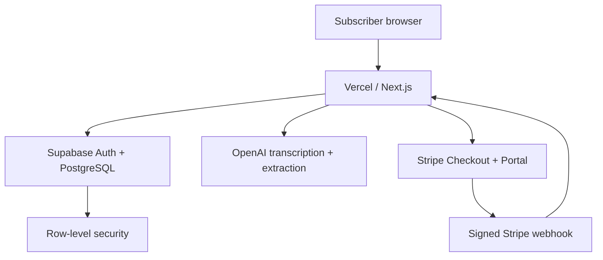
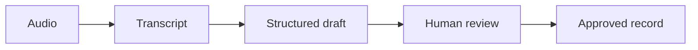

# Architecture

## Request boundaries

1. Supabase Auth places the session in secure cookies.
2. `proxy.ts` refreshes/validates the session.
3. Server routes resolve the user and that user's workspace membership.
4. Finance queries use the user's Supabase server client, so PostgreSQL RLS enforces the same workspace boundary.
5. Stripe and rate-limit operations use the server-only Supabase secret client because no browser user is present.

## Voice workflow

No model call writes to the database. The model reads words into fields (`/api/ai/extract`); the browser previews the Malaysian rule engine's proposal; only a named person's `Approve and post` reaches `/api/ledger/entries`, where the server re-runs the same rule engine (`src/lib/ledger/rules.ts`) and stores the journal it produces. The browser never supplies journal lines.

Posted and rejected entries are immutable (a database trigger enforces it). Bank-statement lines become drafts, which a person then approves or rejects. Reports, the SST-02 working, receivables ageing, the month-end close, the ledger exports and the MyInvois document are all computed from the posted journals by pure functions in `src/lib/ledger/`, covered by `npm run test:unit`.

The public `/demo` runs the same engine entirely in the browser against seeded books, with no account and no model.

## Billing workflow

1. Signed-in non-subscriber requests Stripe Checkout.
2. Stripe collects payment details and creates a trial subscription.
3. Stripe sends a signed webhook.
4. The webhook verifies its signature and synchronises the subscription row.
5. Finance APIs allow only `trialing` or `active` workspaces.

## Database ownership

`auth.users` → `profiles` → `workspace_members` → `workspaces` → finance tables.

All tenant finance tables carry `workspace_id`. Audit records also carry the actor user ID. Tax rules are versioned globally; tax estimates belong to a workspace and always require professional review.
