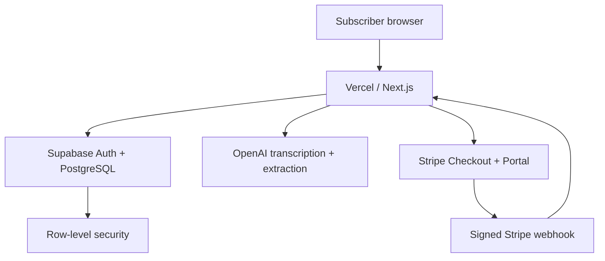
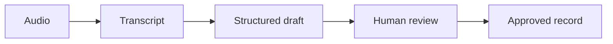

# Architecture

## Request boundaries

1. Supabase Auth places the session in secure cookies.
2. `proxy.ts` refreshes/validates the session.
3. Server routes resolve the user and that user's workspace membership.
4. Finance queries use the user's Supabase server client, so PostgreSQL RLS enforces the same workspace boundary.
5. Stripe and rate-limit operations use the server-only Supabase secret client because no browser user is present.

## Voice workflow

No model call writes to the database. Only the explicit `Approve and save` request reaches the record API.

## Billing workflow

1. Signed-in non-subscriber requests Stripe Checkout.
2. Stripe collects payment details and creates a trial subscription.
3. Stripe sends a signed webhook.
4. The webhook verifies its signature and synchronises the subscription row.
5. Finance APIs allow only `trialing` or `active` workspaces.

## Database ownership

`auth.users` → `profiles` → `workspace_members` → `workspaces` → finance tables.

All tenant finance tables carry `workspace_id`. Audit records also carry the actor user ID. Tax rules are versioned globally; tax estimates belong to a workspace and always require professional review.
